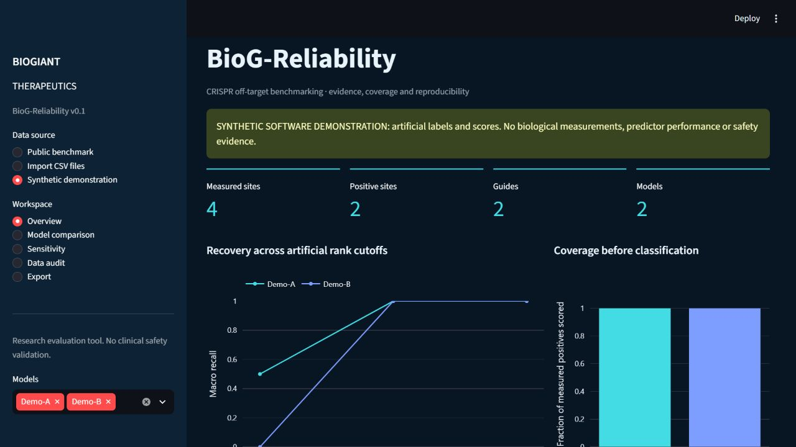

# BioG-Reliability v0.1.0

**BIOGIANT THERAPEUTICS** — Reproducible evaluation of precomputed CRISPR off-target scores.

Candidate nomination, detection limits, missing scores, identity rules and ranking ties
can change benchmark results. BioG-Reliability compares existing predictions with
measured observations and exposes those evaluation choices. This is an independent
evaluation implementation, not a newly developed biological prediction model.
It does not train/run native predictors, design guides, establish improved biological
prediction accuracy or certify clinical safety. No methodological novelty is claimed.

## Install and demonstrate without research data

Supported target: Windows 11, Python 3.13.x and Git; tested with Python 3.13.12.
Other platforms remain unverified. Unpack the reviewed source archive, or clone after
approved publication. From the source root in PowerShell:

~~~powershell
.\scripts\setup.ps1
.\scripts\launch.ps1
~~~

Open **http://127.0.0.1:8501**. The server binds to localhost. If port 8501 is occupied, use scripts/launch.ps1 -Port 8503. A clean checkout defaults
to **Synthetic demonstration**: five artificial site IDs and two artificial score sets.
No biological sequences or observations are bundled. A persistent warning and export
metadata identify the synthetic inputs. These scores support no biological accuracy claim.

Visit Overview, Model comparison, Sensitivity, Data audit and Export. Select Import CSV
files to use your own authorized data. Public benchmark mode requires optional external
inputs. CLI demonstration:

~~~powershell
.venv\Scripts\python.exe -m biog_reliability.cli examples/demo/truth.csv examples/demo/predictions.csv examples/demo/provenance.json --output work/demo
~~~

Open work/demo/analysis.html; CSVs and a provenance/hash manifest accompany it.
The installed biog command takes the same arguments. The wheel provides the API/CLI;
the source archive additionally supplies the dashboard, examples and research scripts.

## Architecture and capabilities

~~~mermaid
flowchart LR
  A[Authorized CSV and provenance JSON] --> B[Validation and dataset adapters]
  B --> C[Cohort, identity and coverage audit]
  C --> D[Metrics, candidate budgets and uncertainty]
  D --> E[CLI and Streamlit]
  D --> F[CSV, HTML and JSON with hashes]
~~~

The package validates schemas, coordinates, strands, assembly and cohort compatibility.
It audits duplicate/conflicting identities, missingness and known train/test overlap;
reports AUROC, AP, trapezoidal AUPRC, coverage and macro/micro recall; compares each
model's available population and identical common cohorts; and provides tie-budget,
threshold and cluster-resampling analyses. Versions, settings, seeds and hashes are recorded.

Unknown sites may consume ranking budget but never become measured classification
negatives. Missing scores are absent rows, not fabricated zeros. Undefined metrics
retain reason codes. Scores are not calibrated safety probabilities.

## Supported inputs

UTF-8 truth CSV: site_id, guide_id, assembly, assay, context, status, measurement.
Status is positive, measured_negative or untested. Measured outcomes are finite;
untested outcomes are blank. Prediction CSV: site_id, guide_id, assembly, model,
score, rank. Higher scores indicate greater predicted activity. Preserve ranks from
the full candidate universe; ranks are positive integers and may tie.

Provenance JSON records dataset/version/HTTPS source/license, assembly, species,
nuclease, assay, context and identity policy. Optional coordinates are 0-based,
half-open intervals with end > start and + or - strand. The published adapter documents
its source-specific identity/PAR normalization; reference-genome sequence validation
is absent. See [input schema](docs/input-schema.md) and [synthetic inputs](examples/demo).

## Verified historical research findings

These are internally verified observations recomputed from deposited scores, separate
from the synthetic demonstration and current software tests. Full aggregate values
are in [research summary](docs/research-summary.json).

### Primary reproduction

Pinned [benchmark source](https://github.com/maren-ha/OffTargetPredictionBenchmark/tree/e82954897a77e95df46370923e9a5213ed7b1e19)
and [Zenodo 20627722 v1.0.0](https://doi.org/10.5281/zenodo.20627722).
The main cohort contains **1,768 measured identities, 114 positives and 26 guides**;
22 guides contribute positive-denominator macro recall.

**20/25 comparisons reproduce** at absolute macro/micro recall tolerance 1e-12.
MOFF, CRISOT, CRISPert and CRISPR-IP match all five cutoffs. **Five CCTop comparisons
remain discrepant** with the stored reference. Pinned upstream-function execution
agrees with BioG's CCTop values; historical reference lineage remains unresolved.

At K=50, CRISPert macro recall is **0.6913048985149298**, micro recovery
**59/114 = 0.5175438596491229**. CCTop rank<=50 admits **72–330 candidates per guide**.
Exact-budget expected macro recall is **0.5069566368346782**, versus inclusive-rank
recall **0.5828298660587062**. Tie-order bounds **0.454842–0.582830** assume uniform
boundary-tie ordering and are not confidence intervals.

The common scored cohort has 395 sites/67 positives. CRISPert AP is 0.7009677411071481;
guide-bootstrap 95% interval **[0.457796, 0.864610]**. The paired CRISPert–MOFF recall@50
interval includes zero. These findings do not establish superiority.

### External retrospective evaluation

[TrueOT v1.1](https://github.com/baolab-rice/CRISPR_OT_scoring/tree/4ff0ccd2493de3dc658747d05fa6bb4fe12ea2c7)
retains 1,897 context/locus-aware observations after six duplicate identities are removed.
Primary guide/study and known CRISPR-NET training-overlap exclusions leave a common
cohort of **911 observations, 93 positives, 15 guides and seven studies**.

| Model | AUROC | Average precision | Guide-bootstrap 95% AP interval |
|---|---:|---:|---|
| CFD | 0.793891474 | 0.365127972 | [0.279184, 0.450216] |
| CRISPR-NET | 0.842291716 | 0.362720181 | [0.280015, 0.488210] |

Training provenance remains incomplete, including CFD. Exclusions do not certify
independence from every training observation. Labels retain source assay definitions;
a universal indel threshold is not imposed. Small cluster counts, assay heterogeneity,
nomination bias and missing quantitative outcomes constrain generalization.

### Engineering scalability

A streaming integrity audit covered **8,207,327 candidate rows** in related CHANGE-seq
and Full GUIDE-seq collections from the pinned
[CRISPR-Bulge archive](https://github.com/OrensteinLab/CRISPR-Bulge/tree/3eddcd5bfcaff00b2bdf29425116ec9756ace870).
These counts are not independent experimental outcomes. Zero-read candidates remain unknown.

Two fresh workers per size used real deposited source prefixes, retaining source
duplicates/dependence. These engineering workloads imply no biological accuracy.

| Rows | Wall seconds | Peak process-tree RSS, MiB |
|---:|---|---|
| 10,000 | 1.770–1.773 | 177.020–177.066 |
| 100,000 | 2.778–2.991 | 262.086–265.566 |
| 1,000,000 | 13.719–14.046 | 1,139.828–1,140.020 |

The million-row CSV is 248,130,942 bytes. Ingestion reached approximately 379k–387k
rows/second; processing 148k–151k rows/second. All six workers recovered from invalid
provenance before valid processing. The Windows host had 24 logical CPUs and about
31.44 GiB RAM; sampling was every 20 ms, with caches unflushed. Times include startup/
recovery and exclude fixture assembly. They are historical measurements, not hardware-
independent guarantees, concurrency tests or long-term memory-leak tests.

## Reproducibility and data rights

The source release contains **no research dataset, sequence-level derived output,
model weight, research report/presentation or previous Git history**. Default CI and
the demonstration need none of these inputs. Original source/synthetic fixtures are
MIT; external research data retain their original terms.

Primary predictions declare CC BY 4.0; underlying truth/database redistribution rights
are unresolved. TrueOT lacks an independently identified standalone reuse license.
CRISPR-Bulge's code MIT declaration does not settle every underlying data right.
Public access is not unrestricted reuse permission. No private input is required for
the synthetic workflow. Research reconstruction needs separately acquired inputs and
applicable rights; the software does not grant those rights.

After reviewing [data provenance/terms](docs/data-provenance.md), authorized users can run:

~~~powershell
.\scripts\reproduce.ps1 -Research -DataTermsAccepted
~~~

The pipeline fetches pinned sources, recomputes primary/external/assay/stress/CCTop
analyses, runs full checks/builds and generates a local report. Downloads are about
795 MB excluding repositories/dependencies, with several GB of working storage.
Checksums are verified. Preserve failed transfers; -SkipDownload may reuse verified
raw caches, never stale processed evidence. Direct fetch scripts require
--acknowledge-data-terms. See [reproducibility](docs/reproducibility.md),
[methods](docs/methodology.md), [catalog](docs/dataset-catalog.md) and [limitations](docs/limitations.md).

Default reproduction and checks are data-free:

~~~powershell
.\scripts\reproduce.ps1
.venv\Scripts\python.exe scripts/verify.py --software-only
.venv\Scripts\python.exe -m pytest
~~~

Full Pytest explicitly skips research tests when external inputs are absent; CI
deliberately deselects them. With prepared inputs, all retained research assertions run.
See [validation record](docs/validation-record.md). Remote CI awaits private-staging
authorization; no passing badge is asserted. See [contributing](CONTRIBUTING.md)
and [security](SECURITY.md).

## References and citation

- Kaufmann et al. (2026), [benchmark](https://doi.org/10.1177/10430342261466407) and [predictions](https://doi.org/10.5281/zenodo.20627722).
- Kota et al. (2021), [TrueOT](https://doi.org/10.1101/2021.08.28.457846).
- Yaish, Asif and Orenstein (2022), [problem formulation/guide-disjoint evaluation](https://doi.org/10.1093/bib/bbac157).
- Yaish and Orenstein (2024), [CRISPR-Bulge](https://doi.org/10.1093/nar/gkae428).
- Lazzarotto et al. (2020), [CHANGE-seq](https://doi.org/10.1038/s41587-020-0555-7).

Use [CITATION.cff](CITATION.cff) and cite original data alongside the software.
Original source and synthetic fixtures: [MIT](LICENSE). External data/dependencies
retain their terms: [third-party notices](THIRD_PARTY_NOTICES.md).
Version **0.1.0** is a local release candidate; publication/visibility/release actions
require explicit approval. See [draft release notes](RELEASE_NOTES.md).
